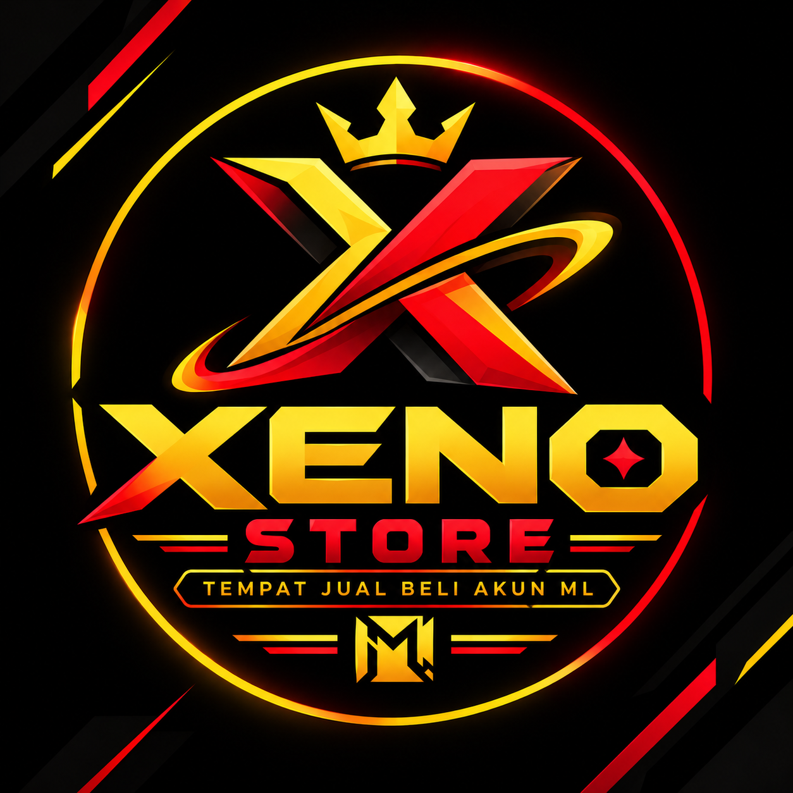

<div align="center">

# ⚡ XENO STORE - MOBILE LEGENDS MARKETPLACE ⚡



<p><em>Marketplace & Admin Panel Modern untuk Jual Beli Akun Mobile Legends: Bang Bang (MLBB)</em></p>

<p>
  
  
  
</p>

</div>

---

## 🚀 Tentang Proyek

**Xeno Store** adalah platform web e-commerce/marketplace mandiri yang dirancang khusus untuk transaksi jual beli akun Mobile Legends secara aman, cepat, dan terstruktur. Menggunakan skema warna futuristik bertema gaming (**Hitam, Merah, dan Emas**), platform ini dilengkapi dengan sistem manajemen inventaris real-time menggunakan **Firebase Firestore**.

---

## ✨ Fitur Utama

### 🛒 Halaman Katalog Utama (`index.html`)
* **Live Search & Filter Canggih:** Cari akun berdasarkan kata kunci, rentang Rank (Epic hingga Mythic Immortal), serta tipe login.
* **Fitur Urutkan (Sorting):** Urutkan produk berdasarkan harga termurah, termahal, skin terbanyak, atau produk terbaru.
* **Detail Produk & Modal Interaktif:** Menampilkan statistik lengkap (jumlah skin, hero, winrate, emblem, dan tipe login).
* **Checkout WhatsApp Otomatis:** Tombol beli yang langsung mengarahkan pembeli ke WhatsApp Admin dengan format pesan transaksi yang rapi.

### 🛡️ Admin Panel Rahasia (`admin.html`)
* **Proteksi Akses PIN:** Halaman admin dilindungi sistem verifikasi PIN rahasia untuk mencegah akses ilegal.
* **Dashboard Statistik:** Ringkasan total stok akun, akun ready, akun terjual, hingga total nilai aset produk.
* **Manajemen CRUD Real-Time:** Tambah, Edit, Ubah Status (Ready/Terjual), dan Hapus data akun langsung tersimpan otomatis ke database **Firebase Firestore**.
* **Custom Thumbnail:** Mendukung input URL gambar/thumbnail secara fleksibel untuk setiap akun.

---

## 🛠️ Teknologi yang Digunakan

* **HTML5 & Modern JavaScript (ES6 Modules)**
* **Tailwind CSS** (Styling & Responsive Design via CDN)
* **Font Awesome 6** (Ikon Pendukung)
* **Google Fonts** (*Orbitron* & *Plus Jakarta Sans*)
* **Firebase Firestore v10** (Cloud Database Real-Time)

---

## 📁 Struktur File Repositori

```text
📦 Xeno-Store
 ┣ 📜 index.html        # Halaman utama katalog toko & pencarian
 ┣ 📜 admin.html        # Halaman panel admin rahasia (CRUD + Firebase)
 ┣ 📜 logo.png          # Logo resmi Xeno Store
 ┗ 📜 README.md         # Dokumentasi proyek
